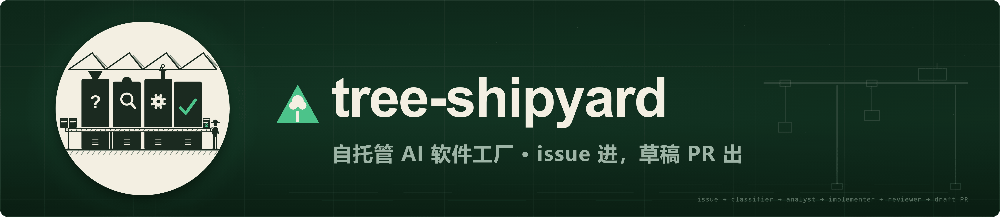

# tree-shipyard

树哥的软件工厂:issue 打上 `factory` 标签,四站 AI 流水线无人值守地把工作变成一份经过独立评审的草稿 Pull Request;人只做判断——标记 ready、合并、或者打回。自托管形态,基于 [eve](https://eve.dev) 框架,由 [vercel-labs/eve-software-factory-template](https://github.com/vercel-labs/eve-software-factory-template) 深度改造而来,v1.0.0 起为独立仓库。

## 它怎么工作

编排器 Foreman(根会话)把每个工单严格顺序送过四个站点,每站都是全新子会话,不继承任何上游上下文:

- **classifier 分诊**(快速模型):判定类型/优先级/可行动性,不可行动就先问清楚而不是做错东西
- **analyst 分析**:在仓库的真实检出上做计划与验收标准
- **implementer 实现**:在自己的沙箱里编码、用仓库自己的检查验证、推送 `factory/*` 分支
- **reviewer 评审**:只看推送的分支、不看实现过程,证据逐条给裁决;request_changes 打回实现,最多 2 轮

长文档(研究备忘、分析细节)以工件 id 在站点间交接,不占会话上下文;跨运行的仓库记忆存在共享的工厂大脑里,每次运行都从它出发。需要前置调研时可插入第五站 researcher。终点是草稿 PR——标记 ready 需要人批准,合并永远不在工具面上。

## 工作怎么进来

- issue 打 `factory` 标签 → 无人值守整线跑完,进度随站点回帖,草稿 PR 关联 issue
- @提及(issue/PR 评论,限 OWNER/MEMBER/COLLABORATOR)→ 有人值守会话,GitHub 写操作等待批准
- `factory/*` 分支红 CI → 自动诊断修复,按 PR 评论计次封顶,只动自己的分支
- PR 打开 → 一条定向评论(给评审者的摘要,不是评审)

## 运行形态(自托管)

常驻专用 Ubuntu 机:pm2 守护 `eve start`(:3000),cloudflared 命名隧道提供公网 HTTPS 入口承接 GitHub webhook(工厂域名 factory.zjordon.com);站点跑在 Docker 沙箱(自建镜像 foreman-station:1,uv + Chromium 烘焙);模型全部智谱 GLM 直连(Anthropic 兼容端点);每日备份 `.eve` 数据面到独立卷并巡检孤儿容器。云端 Vercel 形态保留开关但冻结维护。

细节见 [docs/architecture.md](docs/architecture.md) 与 [docs/自托管实施方案.md](docs/自托管实施方案.md)。

## 运行面板

浏览器打开 `https://factory.zjordon.com/runs/ui`(Basic 认证):管线图与甘特双视图看一个任务在四站间的流转与耗时分布;实时流跟随在途轮,进入站点时自动切换到子会话流;僵尸运行(审批挂起、错误循环)置顶标红。数据面 metadata-only——只有动作名、时长、token、错误码,对话内容永不落盘。

## 安全模型

- 自持 GitHub App:JWT 签 1 小时安装令牌,令牌不进入模型可见路径(沙箱内凭据 arm/disarm,用后即焚)
- 分支结构性安全:`factory/` 前缀强制、拒 main/master、git 永远瞄准字面 URL
- 信任在派发时盖章:无人值守对写操作默认拒绝(标签、限本单评论、草稿 PR 除外),其余走审批门
- 会话与面板路由 Basic fail-closed;webhook 走 HMAC 独立验签

## 配置

完整清单见 `.env.example`,关键项:

| 变量 | 必填 | 说明 |
| --- | --- | --- |
| `FACTORY_REPO` | 是 | 工厂服务的仓库(owner/repo);GitHub App 必须装在它上面 |
| `GITHUB_APP_ID` / `GITHUB_INSTALLATION_ID` / `GITHUB_APP_PRIVATE_KEY`(或 `_PATH`)/ `GITHUB_APP_SLUG` | 是 | 自持 GitHub App 凭据与 @提及名 |
| `GITHUB_WEBHOOK_SECRET` | 是 | webhook HMAC 验签,与 App 的 webhook 设置一致 |
| `ZHIPU_API_KEY` | 是 | 智谱 GLM 密钥(Anthropic 兼容端点) |
| `ROUTE_AUTH_BASIC_USERNAME` / `ROUTE_AUTH_BASIC_PASSWORD` | 是 | 会话与面板路由的 Basic 凭据,生产缺省即拒绝 |
| `FACTORY_SETUP_COMMAND` | 否 | 站点沙箱首次检出后执行的命令(如依赖安装) |
| `FACTORY_LABEL` / `FACTORY_BRANCH_PREFIX` / `FACTORY_BOT_NAME` | 否 | 缺省 `factory` / `factory/` / `GITHUB_APP_SLUG` |
| `FACTORY_SANDBOX_BACKEND` / `FACTORY_BLOB_BACKEND` / `FACTORY_DATA_DIR` | 否 | 自托管开关:Docker 沙箱、本地 Blob 后端、数据目录 |

## 本地开发

```bash
pnpm install
pnpm dev            # eve dev TUI(/model 链模型;.env.local 的值不要加引号)
pnpm validate       # check + typecheck + eve info,要求 0 错 0 警(eve info 需先注入 env)
pnpm eval --tag fast
docker build -t foreman-station:1 agent/sandbox/   # 站点镜像,eve build 前必须先建
pnpm build && pnpm exec eve start
```

## 文档地图

- [docs/architecture.md](docs/architecture.md) — 架构、信任模型、数据落点、观测面(§2.10)
- [docs/自托管实施方案.md](docs/自托管实施方案.md) — M1-M6 全程实施方案
- [docs/运维手册.md](docs/运维手册.md) — 常驻运维:pm2 规矩、备份、巡检、僵尸处置
- [docs/部署手册.md](docs/部署手册.md) — 首次部署的十大坑位手册(云端形态)
- `docs/implement-plan/` — M1 至 M6 六份实施计划与执行记录
- [CHANGELOG.md](CHANGELOG.md) — 版本变更

## 与上游模板的关系

v1.0.0 时脱离 fork 网络独立;保留 `upstream` remote 作为模板修复的 cherry-pick 通道。相对模板的主要改造:智谱 GLM 直连、Docker 站点沙箱与自建镜像、pm2 常驻与 Basic 鉴权、cloudflared 隧道、本地 Blob 后端、运行记录面与只读面板、`factory/` 前缀结构化强制。MIT 许可沿用。

## 参考

- [eve 框架文档](https://eve.dev/docs/introduction)
- [上游模板](https://github.com/vercel-labs/eve-software-factory-template)
- [GitHub Tools eve Extension](https://github-tools.com/frameworks/eve-extension)
