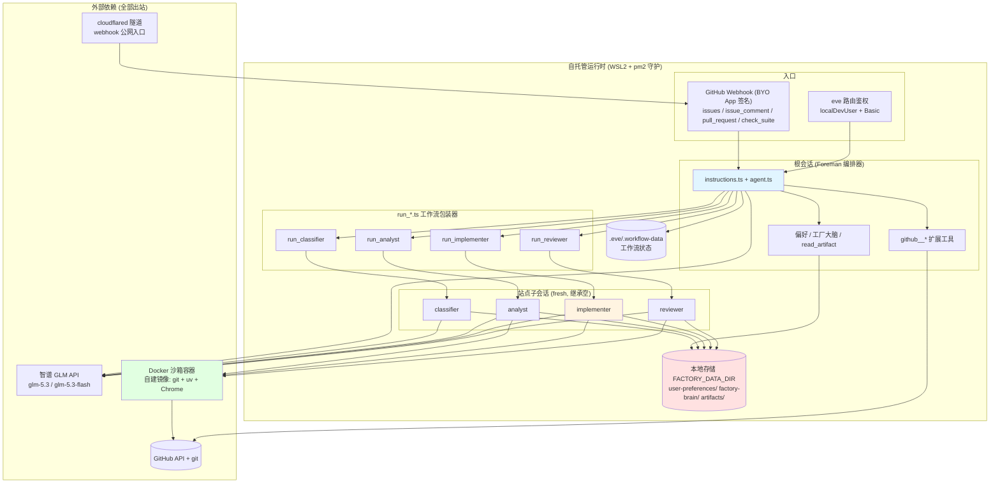
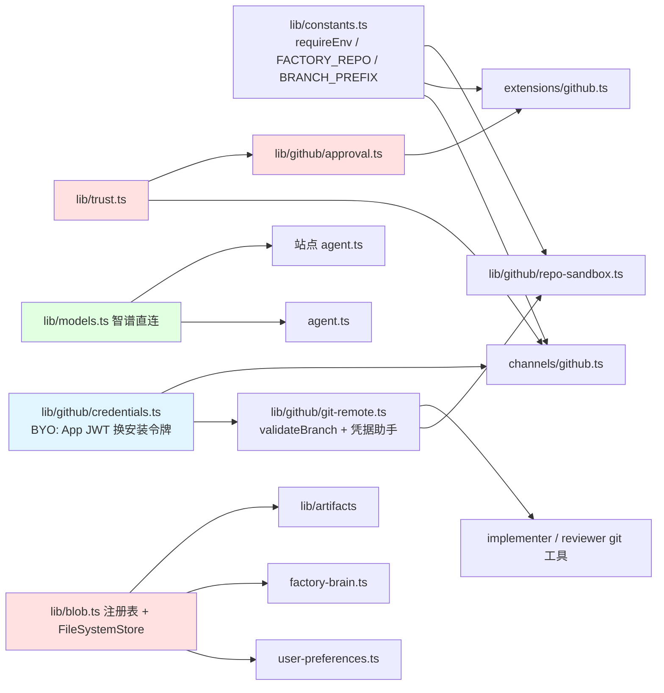

# eve Software Factory(自托管形态)- 架构文档

> 基准:out/架构分析.md(上游云端形态,2026-09-30)按自托管改造方案(docs/自托管实施方案.md,issue #1)重写
> 状态:目标架构(M1-M4 实施跟踪中);实施前本文描述的是改造完成后的形态
> 本 fork 的既有改造:模型层已切换智谱 GLM 直连;`factory/` 分支前缀已结构性强制(187bc46)

## 1. 项目概览

### 1.1 项目信息

| 项目 | 内容 |
|------|------|
| 名称 | eve-software-factory-template 自托管形态(代理名沿用 Foreman) |
| 语言 | TypeScript (strict, ESM, NodeNext 模块解析) |
| 类型 | AI Agent 编排器 / 软件工厂模板,**自有机器部署** |
| 描述 | 基于 eve 框架的编排 Agent,把 GitHub 工单流转过四个站点(classifier → analyst → implementer → reviewer),交付经审查的草稿 Pull Request;运行时、凭据、存储、沙箱全部本地化,仅保留对 GitHub 与模型 API 的出站依赖 |
| 运行平台 | **自托管**:`eve build` + `eve start`(Nitro Node 服务,WSL2 内 pm2 守护)/ 本地 TUI(`pnpm dev`,同一运行时) |
| 双形态 | `FACTORY_SANDBOX_BACKEND=docker|vercel` 等开关保留云端兼容形态(冻结维护,见 §5) |

### 1.2 目录结构(改造后)

```text
eve-software-factory-template/
├── agent/
│   ├── agent.ts              # 根 Agent(编排器):模型 + 会话预算;connections 不再含 Linear
│   ├── instructions.ts       # 编排器系统提示词,构建期注入 FACTORY_REPO
│   ├── sandbox.ts            # 根沙箱(Docker 后端)
│   ├── channels/
│   │   ├── github.ts         # GitHub 通道:BYO App 凭据(env 三变量),钩子与信任盖章不变
│   │   └── eve.ts            # eve 路由鉴权(localDevUser + Basic auth,替代 vercelOidc)
│   ├── extensions/
│   │   └── github.ts         # github__* 扩展工具(经通道凭据携带安装令牌)
│   ├── sandbox/
│   │   └── Dockerfile        # 站点沙箱镜像:git + uv + Chrome(e2e 真跑的独有能力)
│   ├── subagents/            # 5 个站点不变(classifier/researcher/analyst/implementer/reviewer)
│   │   └── */sandbox.ts      # 共享 createFactoryEnvironment → 指向自建镜像
│   ├── tools/                # run_*.ts 包装器、偏好/大脑/工件工具不变
│   ├── lib/
│   │   ├── constants.ts      # requireEnv + FACTORY_REPO(+ FACTORY_BRANCH_PREFIX);linearAuth 已删
│   │   ├── trust.ts          # 信任权威:不变
│   │   ├── blob.ts           # 存储抽象:FileSystemStore 后端 + 命名空间注册表(守卫不变)
│   │   ├── models.ts         # 智谱 GLM 直连(glm-5.3 / glm-5.3-flash)+ 上下文窗口表
│   │   └── github/
│   │       ├── approval.ts   # 8 个审批策略:不变
│   │       ├── git-remote.ts # validateBranch(强制 factory/ 前缀)+ 凭据助手模式 + REMOTE_URL
│   │       ├── repo-sandbox.ts       # factoryInit:克隆 + FACTORY_SETUP_COMMAND(凭据助手注入)
│   │       └── credentials.ts        # BYO App:App JWT → 1 小时安装令牌(eve 原生铸造)
│   └── skills/               # writing-quality / triaging-issues(github-linear-bridging 随 Linear 剥离)
├── docs/
│   ├── architecture.md       # 本文件
│   └── 自托管实施方案.md      # M1-M4 实施计划(issue #1)
├── evals/                    # needs-connect 用例改为 BYO 手动验证清单
└── agent/channels/linear.ts、agent/connections/linear.ts   # 已删除
```

## 2. 架构设计

### 2.1 架构模式

继承上游全部核心模式,替换的只有"托管层":

- **文件系统驱动的多 Agent 编排**:不变(eve 从 `agent/` 目录发现能力,无中央注册表)
- **编排器-工作者 / 管道+评审环 / 策略对象 / 零信任输入+单一信任权威 / 命名空间注册表 / 结构化交接**:全部不变(§2.5)
- **自托管运行时(新)**:Nitro Node 服务由 pm2 守护于 WSL2;工作流状态本地持久化(`.eve/.workflow-data`);无 Vercel 运行时依赖
- **自带凭据(新)**:GitHub App 自持(私钥在本机),eve 原生完成 App JWT → 安装令牌交换与 webhook 签名校验;模型 API 直连智谱;无 Connect 中间层

### 2.2 核心模块

| 模块 | 职责 | 自托管改造点 |
|------|------|------|
| 编排器 (Foreman) | 按序调度站点、验证交接、评审环(≤2 轮)、开草稿 PR | 无变化 |
| GitHub 通道 | issue 标签/提及/CI 失败/PR 事件入口;派发时盖章信任 | 凭据块换 BYO 三变量;webhook 经 cloudflared 抵达 `/eve/v1/github` |
| 信任权威 / 审批策略 | 单一信任权威;8 个策略函数 | 无变化 |
| Git 安全 | validateBranch(拒绝 main/master/refs//HEAD/**非 factory/ 前缀**)、字面 REMOTE_URL | 令牌注入方式改变(见 §2.6) |
| 站点沙箱 | 共享环境 + 每会话 factoryInit(克隆、FACTORY_SETUP_COMMAND) | Docker 自建镜像(git+uv+Chrome);镜像预装后 setup 简化 |
| Blob 层 | 命名空间注册表 + 偏好/大脑/工件读写 | 后端换 FileSystemStore(`FACTORY_DATA_DIR`);注册表与守卫原样 |
| Linear 通道+连接 | — | **整体剥离**(模块加载不再要求 LINEAR_CONNECTOR) |
| 路由鉴权 | `/eve/` 与 `/.well-known/workflow/` 入口保护 | vercelOidc → Basic auth |

### 2.3 站点分工

| 站点 | 模型(智谱直连) | 沙箱 | 产出 |
|------|------|------|------|
| classifier | `glm-5.3-flash` | 无(纯文本) | 类型/优先级/复杂度/是否可行动 |
| researcher(可选) | `glm-5.3-flash` | 无 | 带引用的研究结论 + 工件 |
| analyst | `glm-5.3` | Docker 克隆 | 计划/风险/验收标准/测试策略 |
| implementer | `glm-5.3`(最强档) | Docker 克隆 | `factory/*` 分支 + 逐文件摘要 + 验证结果 |
| reviewer | `glm-5.3` | Docker 克隆 | approve / request_changes,逐条验收判定 |

模型集中 `agent/lib/models.ts`,每站附 `modelContextWindowTokens`(自定义模型无网关元数据,靠该逃生舱字段编译压缩配置)。单一供应商是本 fork 的既定取舍(上游 implementer/reviewer 异厂商互审的设计因此让位)。

### 2.4 架构图



### 2.5 信任与授权模型(不变量,原样继承)

- **信任在派发时决定,不在提示词里**:GitHub 通道对 OWNER/MEMBER/COLLABORATOR 提及盖 `trusted`;`factory` 标签进件把会话 auth 重写为自治主体并盖章 intake issue 号。自托管下事件来源从 Connect 转发变为 BYO App webhook(签名校验同强度),信任推导逻辑零改动。
- **审批谓词即授权策略**:8 个策略(write/comment/label/ship/createPR/closeIssue/updateIssue/factoryBrain)原样;自治运行被 `denied` 而非挂起;草稿 PR 是无人值守天花板,合并不在工具面。
- **工厂大脑写权限**:自治运行禁写,受信调用直写——自托管不变。

### 2.6 凭据与沙箱模型(自托管的关键差异)

| 环节 | 云端形态(冻结) | 自托管形态 | 性质 |
|------|------|------|------|
| GitHub App 凭据 | Vercel Connect 托管,无私钥 | 本机持 PEM 私钥,eve 原生 JWT 换 1 小时安装令牌 | 等价(密钥保管责任转移给本机) |
| webhook 校验 | Connect OIDC 签名 | GitHub webhook secret HMAC(eve 原生) | 等价 |
| 站点 git 凭据 | **防火墙 header 注入,令牌永不进沙箱** | 凭据助手模式:工具代码(非模型)把短期令牌写入沙箱内 credential helper,finally 清除 | **降级**:令牌短暂存在于沙箱(1 小时有效 + 用后即焚 + 容器隔离) |
| 沙箱 | Vercel 托管沙箱(防火墙能力) | Docker 容器,networkPolicy 仅 allow-all/deny-all | 可接受,见实施方案 §6 |
| 站点内命令 | 模型驱动,结构性惰性(push_branch 只准 factory/*) | 同左(validateBranch 强制前缀已在 187bc46 落地) | 不变 |

### 2.7 数据落点

| 数据 | 位置 | 备份对象 |
|------|------|------|
| 工作流状态 | `.eve/.workflow-data/` | 是(M4) |
| 偏好 / 工厂大脑 / 工件 | `FACTORY_DATA_DIR`(默认 `.eve/blob-data/`) | 是(M4) |
| git 线程记忆(CI 修复环计数) | GitHub PR 评论(远端) | 随仓库 |

## 3. 依赖关系

### 3.1 外部服务依赖(自托管形态)

| 依赖 | 用途 | 方向 |
|------|------|------|
| GitHub(API + git + webhook) | 工单源、交付目标、事件入口 | 出站 API/git;入站仅 webhook(经隧道) |
| 智谱 GLM API | 全部六类模型调用 | 出站 |
| cloudflared | webhook 公网 HTTPS 入口 | 常驻隧道进程 |
| Docker Desktop(WSL2 后端) | 站点沙箱容器 | 本机 |

### 3.2 代码依赖变化

- 删除:`@vercel/connect`、`@vercel/blob`(FileSystemStore 为本地实现)
- 保留:eve、@github-tools/eve-extension、ai、zod、@ai-sdk/anthropic(智谱直连)
- 新增:无硬新增(FileSystemStore 用 Node 内建 fs)

### 3.3 模块依赖图(简化,改造后)



## 4. 设计亮点与权衡(自托管视角)

- **不变的内核**:文件系统发现、策略对象授权、结构化工件交接、命名空间存储、站点继承空、审批卡不进站点——这些与托管平台无关的模式整体保留,是本次改造范围可控的原因。
- **出站化**:除 webhook 入口一条隧道外,一切依赖均为出站调用;无域名时可退化为轮询适配器(纯出站,零入口)。
- **沙箱即能力**:自建镜像预装 uv + Chrome,使 e2e 在流水线内真实执行——云端形态做不到的独有能力。
- **降级是知情的**:凭据短暂进沙箱、机器关机流水线停、隧道稳定性,三项均已记录于实施方案 §6 并给出缓解;不假装它们不存在。
- **双形态收敛于开关**:`FACTORY_SANDBOX_BACKEND` 等环境变量把分叉点收敛在少数文件,避免 if 散落全仓;云端 A/B 冻结在 187bc46,不再从自托管主线部署。

## 5. 与云端形态的关系

| 形态 | 状态 | 服务对象 |
|------|------|------|
| 云端工厂 A(eve-software-factory-template 项目) | 冻结维护 | factory-playground |
| 云端工厂 B(eve-factory-examination 项目) | 冻结维护,本地版验收后退役 | examination-system(过渡期) |
| 自托管本形态 | 实施中(issue #1) | 先测试仓库,按仓库切换协议接管 examination-system |

**仓库切换协议**:任一时刻一个仓库只安装一个工厂 App;切换 = 卸载旧 App 安装 → 安装新 App → 打标签验证,分钟级可逆。

## 6. 总结

上游架构的价值在"编排薄、站点专、信任集中、副作用惰性化"——这些全部与托管平台无关。自托管改造动的是三件外套(运行时、凭据代理、存储/沙箱后端),内核一件没动;唯一的实质降级(沙箱凭据注入)已被命名、记录并缓解。最终形态:一台你自己的机器、一个你自持的 GitHub App、一条隧道、零 Vercel。
